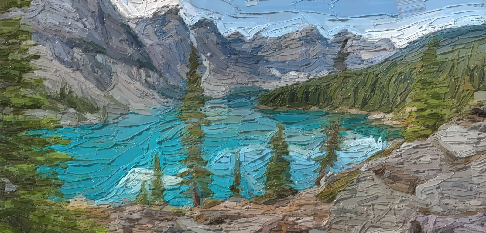
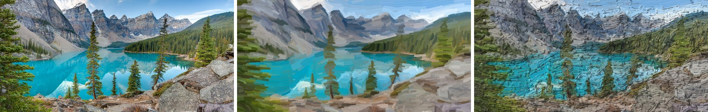
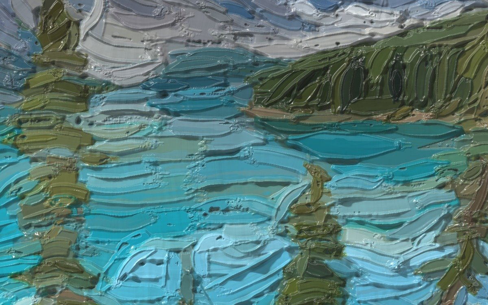

<h1 align="center">Impasto</h1>

<p align="center">
  <b>Turn a photo into a palette-knife oil painting you can relight.</b><br>
  A deterministic paint simulation in plain TypeScript: plans knife strokes from an image, pushes real paint volume around a canvas, and renders the dried relief under a movable light.
</p>

<p align="center">
  <a href="docs/images/demo.mp4"></a><br>
  <sub>▶ <a href="docs/images/demo.mp4">Watch the demo</a> (43 s): painting a photo in the browser playground, then turning the light.</sub>
</p>

<p align="center">
  
</p>

<p align="center">
  <br>
  <sub>Photo → stroke plan → simulated paint, relit on the CPU.</sub>
</p>

> [!NOTE]
> Impasto is experimental. The library API is usable but may still change, and it is not yet published to npm.

## Features

- **Photo in, painting out.** A coarse-to-fine planner (underpainting, block-in, masses, forms, detail, contours, accents) decides where every knife stroke goes, at what width and pressure, and with what paint on the blade.
- **Simulated paint, not a filter.** Each stroke is dragged through a height-field simulation that conserves paint volume: plowed berms, terminal heaps, wet pickup, stiff paint that holds its shape. Colours mix with Kubelka–Munk.
- **Relightable.** The result is a height and colour surface, not just a picture. Move the light and the ridges, cast shadows and satin highlights follow.
- **Live viewer.** Relight in the browser with WebGPU, fall back to WebGL2, then to a static image. It never fails to draw.
- **Deterministic.** The same photo and seed give byte-identical output on any JavaScript engine. Tests pin the plan and image digests.
- **Zero runtime dependencies.** Runs in browsers, Web Workers and Node 22+.
- **Portable output.** Save surfaces as compact `.impasto` files (about 6 bytes per cell) and export every stroke as plain JSON.

<p align="center">
  <br>
  <sub>1:1 detail. One pixel is 0.1 mm of canvas.</sub>
</p>

## Quick start

You need **Node.js 22** or newer. The engine lives in [`sim/`](sim).

```sh
git clone https://github.com/donghaxkim/impasto.git
cd impasto/sim
npm install

# Paint the sample photo (sim/tests/fixtures/lake.png) into sim/out/
npm run paint -- --look oil --width 240 --export-surface

# Build a self-contained page to relight it in your browser
npm run viewer -- out/lake.impasto      # writes out/viewer-lake.html
```

Open `out/viewer-lake.html` straight from disk. Drag the canvas to move the light, and pick **Oil** in the look menu.

To paint your own photo, pass its path: `npm run paint -- photo.png --look oil --width 240`.

> Painting is CPU-bound and scales with canvas area. A 240 mm wide canvas takes roughly 2–4 minutes. Use `--width 120` for quicker tries, or `--plan-only` to see just the stroke plan in seconds.

## Use it as a library

Until the package is on npm, link it from a local checkout:

```jsonc
// your-app/package.json
"dependencies": { "impasto-sim": "file:../impasto/sim" }
```

Render a photo, then relight it live:

```ts
import { renderImpasto } from 'impasto-sim';
import { createImpastoViewer, attachPointerLight } from 'impasto-sim/viewer';

const result = await renderImpasto(file, {   // File/Blob, ImageBitmap, , <canvas> or ImageData
  preset: 'oil',
  widthMm: 240,                              // physical canvas width: more detail, more time
  onProgress: ({ fraction }) => (bar.value = fraction),
});

const viewer = await createImpastoViewer(canvas, result.surface, {
  look: result.light.look,
  light: result.light,
  fallback: result.image,                    // used if neither WebGPU nor WebGL2 is available
});
attachPointerLight(viewer);                  // drag to move the light
```

Each layer takes seconds of synchronous work, so on a web page run the render in a worker:

```ts
import ImpastoWorker from 'impasto-sim/worker?worker';   // Vite syntax
import { renderInWorker } from 'impasto-sim';

const result = await renderInWorker(new ImpastoWorker(), file, { preset: 'oil', signal });
```

The library also does per-layer snapshots for animating the painting as it builds (`onLayer`), aborting (`signal`), stroke export (`result.strokeList`) and `.impasto` save and load (`encodeSurface` / `decodeSurface`). See the **[full API reference](sim/README.md#library-api)**.

## How it works

```
photo ─▶ analysis ─▶ stroke planner ─▶ paint simulation ─▶ surface ─▶ relight (CPU / WebGPU / WebGL2)
         image.ts     planner.ts        execute.ts            surface.ts  relight*.ts, viewer.ts
         structure.ts forms.ts          tool.ts, canvas.ts
```

1. **Analysis.** The photo is resampled onto a millimetre grid in OKLab. From it come an edge-following direction field, detail and silhouette maps, and a hierarchy of shapes.
2. **Planning.** Layers of knives run from 15 mm down to 2.4 mm. Each layer paints only where the canvas still differs from the image at that scale. Strokes stay inside their shapes and follow the form.
3. **Simulation.** Each knife is loaded and dragged across a woven canvas. Paint is plowed, picked up, deposited and heaped, with volume conserved. After each layer the planner sees what the paint really did.
4. **Rendering.** The height and colour surface is lit with a GGX coat, ray-marched shadows and cavity occlusion. The WebGPU and WebGL2 ports match the CPU reference to within about half an 8-bit level.

The design notes cover the details: modelling choices, stroke primitives, looks and the planner ([`sim/README.md`](sim/README.md)). The research the planner and simulation draw on is in [`sim/docs/prior-art-research.md`](sim/docs/prior-art-research.md).

## Repository layout

| Path | What it is |
| --- | --- |
| [`sim/`](sim) | **The engine and library** (`impasto-sim`): planner, simulation, renderers, viewer, tests |
| `src/`, `index.html` | The original Milestone 0 WebGPU prototype: two authored scenes under a movable light (`npm run dev` at the root) |
| `review/` | Visual review notes and captures from early milestones |

## Development

All commands run in `sim/`:

```sh
npm test                 # physics, stroke primitives, planner, determinism and API tests
npm run typecheck
npm run build            # builds dist/
npm run bench -- --quick # stage-by-stage timing
npm run diagnose -- --fast --look oil   # crops, maps and quality metrics for a scene
```

The browser tests (`npm run test:viewer`, `npm run gpu-parity`) run headless Chromium through Playwright. A few helper scripts in `sim/tests/` need Python with Pillow.

Paint code must stay deterministic. Use `dmath.ts` instead of `Math.sin`, `Math.pow`, `Math.exp` or `Math.random`, and keep sorts stable with total-order keys.

## Acknowledgements

The planner builds on ideas from Hertzmann's *Painterly Rendering with Curved Brush Strokes of Multiple Sizes* (1998), Im2Oil and Paint Transformer. The simulation draws on Baxter et al.'s IMPaSTo and Sumner et al.'s height-field plowing. Shape segmentation uses Felzenszwalb–Huttenlocher superpixels. Specular anti-aliasing follows Kaplanyan et al. No third-party code is included.

## License

[MIT](LICENSE)
